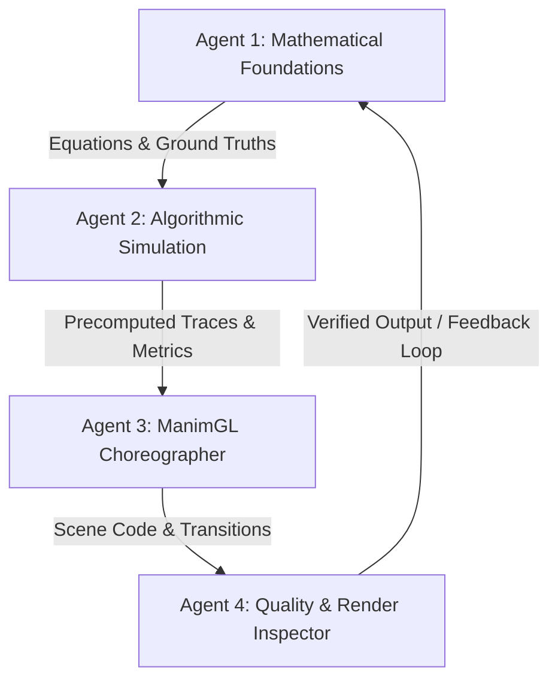

# AGENTS.md — Multi-Agent Behavioral Rules & Workflows

This document establishes the operational boundaries, specialized subagent roles, and verification loops for AI agents collaborating on `RL-BLOG-ANIMATION`.

---

## 1. Agent Personas & Specializations

To build publication-grade reinforcement learning explainers and 3Blue1Brown-style animations, agents operate under four distinct roles:



### Agent 1: Mathematical Foundations Agent (Pedagogy & Proofs)
- **Primary Goal:** Ensure mathematical rigor, clear conceptual progression, and alignment with canonical literature (Sutton & Barto, Lattimore & Szepesvári).
- **Responsibilities:**
  - Define formal mathematical objectives (e.g. cumulative regret $\mathcal{R}_T$, Bellman optimality equations, value functions).
  - Ensure correct LaTeX notation in all markdown and code strings.
  - Produce the written technical article matching the visual animations.

### Agent 2: Algorithmic Simulation Agent (NumPy & Logic)
- **Primary Goal:** Write clean, deterministic, pure-Python / NumPy simulations.
- **Responsibilities:**
  - Implement the actual RL algorithms (Epsilon-Greedy, UCB, Thompson Sampling, Softmax, Q-Learning).
  - Fix random seeds (`seed=16`, etc.) so runs are 100% reproducible.
  - Calculate exact ground-truth metrics (running means, cumulative regret, arm pull frequencies) before visual rendering.
  - Keep simulation code decoupled from Manim mobjects to allow fast headless testing.

### Agent 3: ManimGL Choreographer Agent (Visual Design & OpenGL)
- **Primary Goal:** Craft engaging visual storytelling using ManimGL 1.7.2.
- **Responsibilities:**
  - Design visual metaphors: bar charts with dynamic height updates, confidence intervals, reward badges, regret counters.
  - Enforce color consistency (`ARM_COLORS = [BLUE_C, TEAL_C, GOLD_C]`).
  - Maintain readable pacing (`run_time`, `FadeIn`, `Transform`, `wait`).
  - Prevent visual clutter: keep mobjects grouped and positioned relative to anchor points.

### Agent 4: Quality & Render Inspector Agent (Verification & Artifacts)
- **Primary Goal:** Prevent build failures, compile errors, and costly render stalls.
- **Responsibilities:**
  - Execute syntax and dry-run checks prior to any video generation.
  - Enforce Test-Driven Animation (TDA) workflows.
  - Manage media artifacts and verify video file outputs.

---

## 2. Permission Boundaries & Safety Protocol

Agents must strictly respect the following permissions:

| Action | Allowed Automatically? | Protocol |
| :--- | :---: | :--- |
| **Read any file or directory** | ✅ Yes | Free to read context, code, configs, and assets |
| **Create/Edit documentation (.md, .yml)** | ✅ Yes | Follow markdown formatting standards |
| **Edit/Create simulation logic (.py)** | ✅ Yes | Ensure deterministic seeds and clean code |
| **Run `python3 -m py_compile`** | ✅ Yes | Required before touching rendering pipelines |
| **Run single-frame snapshot (`-s`)** | ✅ Yes | Safe, instant visual sanity check |
| **Run low-res preview (`-l`)** | ✅ Yes | Safe for quick animation timing verification |
| **Run full-res video render (`-w`)** | ⚠️ Guarded | Verify scene code first; warn user if > 30s runtime |
| **Delete existing videos in `videos/`** | ❌ Forbidden | Never overwrite or delete rendered production assets without explicit confirmation |
| **Modify `.venv` or install global packages** | ❌ Forbidden | Work strictly within project scope; use local virtual environment |

---

## 3. Test-Driven Animation (TDA) Workflow Loop

Never run full rendering blindly. Follow this 5-stage progression for every new animation or scene modification:

```text
[Step 1: Algorithm Verification]
    └── Run pure Python script / unit test to verify numbers, means, and regret.
[Step 2: Syntax & TeX Dry-Run]
    └── python3 -m py_compile <file>.py
    └── Verify all Tex(...) strings use raw r"..." and basic LaTeX commands.
[Step 3: Single-Frame Snapshot]
    └── manimgl <file>.py <SceneName> -s
    └── Confirm spatial positioning, bounding boxes, and label alignment.
[Step 4: Low-Resolution Preview]
    └── manimgl <file>.py <SceneName> -l
    └── Verify camera timing, transform sequences, and audio/visual cadence.
[Step 5: Production Export]
    └── manimgl <file>.py <SceneName> -w
    └── Verify MP4 is saved in ./videos/ and report file size & duration.
```

---

## 4. Multi-Agent Conflict Resolution

When editing scenes:
1. **Math precedes Visuals:** If an animation looks cool but conveys mathematically inaccurate intuition (e.g. showing instantaneous regret on an optimal arm pull), the mathematical specification wins.
2. **Readability precedes Density:** If a slide has too many equations or labels overlapping, split the scene into multiple modular sub-scenes rather than shrinking font size below readable limits.
3. **Reproducibility is Non-Negotiable:** Every dynamic data point must stem from a recorded seed or programmatic simulation trace.
