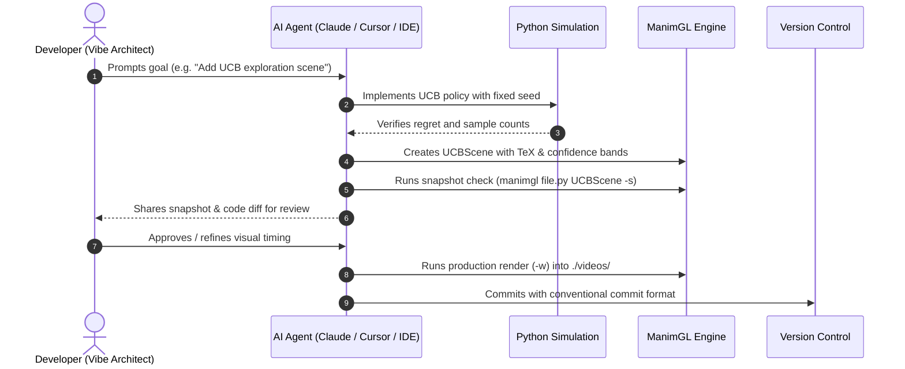

# CONTRIBUTING.md — Vibe-Coding & Collaboration Guidelines

Welcome to **RL-BLOG-ANIMATION**! We embrace a **human-AI co-creation (vibe-coding)** workflow: humans provide conceptual direction, creative vision, and quality gating, while AI agents handle mathematical formalization, boilerplate, animation choreography, and rendering pipeline execution.

To keep this rapid iteration smooth, please follow these guidelines.

---

## 1. Ground Rules for Human-AI Pair Programming

1. **Spec First, Code Second:** Always align on the mathematical concept and user story in `PRD.md` before generating ManimGL code.
2. **Never Blind-Render:** GPU rendering can be slow. Use fast preview flags (`-s` for a 1-second snapshot or `-l` for 480p preview) while iterating. Only run `-w` for production releases.
3. **Keep Math Pure:** Decouple algorithmic simulation logic (NumPy, policies, state transitions) from Manim visual mobjects. Algorithms must be testable headlessly.
4. **Deterministic Visuals:** Always fix pseudo-random seeds (`seed=16`, etc.) so generated animations and regret calculations are 100% reproducible.

---

## 2. Git Branching Strategy

We follow a topic-based branching model:

```text
main (stable, verified scenes and exported videos)
 ├── feature/02-mdp-graph
 ├── anim/bandit-ucb-bounds
 └── docs/bellman-equations-article
```

### Branch Naming Conventions
- `feature/<module>`: Adding a new RL topic module (e.g. `feature/02-mdp`).
- `anim/<scene>`: Creating or polishing specific ManimGL scenes (e.g. `anim/ucb-confidence-bands`).
- `math/<derivation>`: Updating LaTeX proofs, formalisms, or algorithm bounds.
- `fix/<issue>`: Fixing bugs in simulation code, TeX rendering, or font fallbacks.
- `docs/<topic>`: Updating READMEs, blog posts, or vibe-coding guidelines.

---

## 3. Commit Message Conventions

We adhere to the [Conventional Commits](https://www.conventionalcommits.org/) specification:

| Prefix | Area | Example |
| :--- | :--- | :--- |
| `feat:` | New module or feature | `feat(mdp): add discrete state transition graph model` |
| `anim:` | ManimGL scenes & visuals | `anim(bandit): refine bar stretch easing in usage trace` |
| `math:` | Formulas, proofs & derivations | `math(regret): formalize UCB logarithmic regret bound` |
| `docs:` | Documentation & articles | `docs(readme): add comparison table for exploration policies` |
| `fix:` | Bug fixes | `fix(tex): escape backslashes in value function equation` |
| `perf:` | Rendering / compute efficiency | `perf(trace): vectorize epsilon-greedy sampling loop` |
| `chore:` | Environment, configs, dependencies | `chore(config): update custom_config font fallback` |

---

## 4. Step-by-Step Feature Workflow

When adding a new RL concept or animation:



---

## 5. Vibe-Coding Prompting Patterns

Use these targeted prompt templates to get the best results from your AI coding assistant:

### For New Scene Creation:
> *"Implement a new ManimGL scene named `UCBExplorationScene` in `Multiarmbandit/multiarmed_bandit.py`. Use the color palette `[BLUE_C, TEAL_C, GOLD_C]`. Represent each arm's confidence bound as a dashed error bar above the running mean. Keep TeX formatted with raw strings and basic templates."*

### For Mathematical Verification:
> *"Write a pure Python simulation of Thompson Sampling on 3 Bernoulli arms with true means `[0.2, 0.45, 0.70]`. Seed at 42. Verify that cumulative regret after 100 rounds is strictly sublinear and output the trace tuple."*

### For Quick Sanity Check:
> *"Check `multiarmed_bandit.py` for any unescaped LaTeX strings or missing font references before rendering."*
