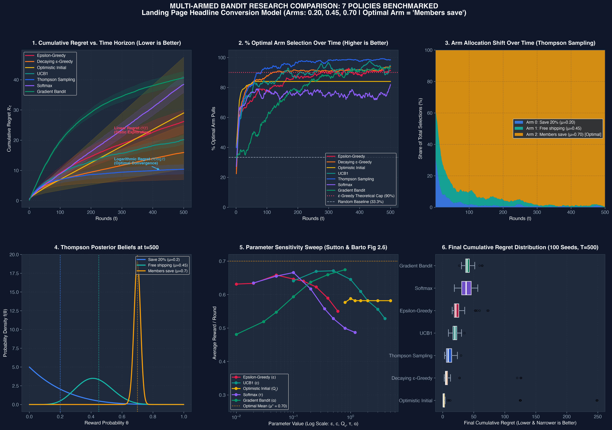

# Multi-Armed Bandit Problem

> ⚡ **Quick Links:**
> - 🖥️ **[Instant Terminal Simulator (Zero Graphics)](simulate.py):** Run `python3 simulate.py` to benchmark 7 policies in milliseconds.
> - 📋 **[Problem Card & Cheatsheet](problem.md):** Concise mathematical formulation & parameter reference.
> - 📊 **[Empirical Comparison Visualizations (6 Plots)](visualizations/all_comparisons_dashboard.png):** High-res publication benchmarks across 7 policies.
> - 🎬 **[Pre-Rendered Video Assets](videos/):** Watch `videos/BanditExplainer.mp4` immediately without installing rendering dependencies.
> - 🎨 **[ManimGL Scene Source](multiarmed_bandit.py):** 3Blue1Brown vector animation scripts.

---

The **multi-armed bandit (MAB)** problem models sequential decisions under uncertainty. At each step, an agent chooses one action, receives a reward, and uses that observation to improve future choices.

The name comes from a row of slot machines, sometimes called one-armed bandits. Each machine has an unknown probability of paying out. The goal is to discover which machine is best while still earning as much reward as possible during the learning process.

## What Problem Does It Solve?

A multi-armed bandit solves the problem of choosing among several uncertain actions when:

- The outcome of each action is initially unknown.
- Feedback arrives after the chosen action.
- The agent must make decisions repeatedly.
- Trying an action provides information, but may produce less immediate reward.
- The agent wants to maximize reward over time.

Unlike ordinary supervised learning, there is no label for every possible action. The agent only observes the result of the action it selected.

## Why Does This Problem Matter?

Many real systems must balance two competing goals:

- **Exploration:** try actions that are uncertain in order to learn more.
- **Exploitation:** choose the action currently believed to be best.

Always exploiting can make the agent settle on a mediocre action because of noisy early observations. Always exploring wastes opportunities to receive high reward. MAB algorithms provide principled ways to manage this trade-off.

This problem matters because decisions often have an immediate cost or benefit. A poor decision is not only a wrong prediction; it can also mean lost revenue, a worse user experience, or a missed opportunity.

## Formal Mathematical Model

Assume there are $K$ actions, called **arms**, and a time horizon of $T$ rounds.

At round $t$:

1. The agent selects an arm $A_t \in \{1, 2, ..., K\}$.
2. The selected arm produces reward $R_t$.
3. The agent observes $R_t$ and updates its estimates.

Each arm $i$ has an unknown expected reward:

$$
\mu_i = \mathbb{E}[R_t \mid A_t = i]
$$

The best arm has expected reward:

$$
\mu^* = \max_{i \in \{1, ..., K\}} \mu_i
$$

The main objective is to maximize expected cumulative reward:

$$
\max \mathbb{E}\left[\sum_{t=1}^{T} R_t\right]
$$

Equivalently, the agent tries to minimize **cumulative regret**.

### Instantaneous Regret

If arm $A_t$ is selected at time $t$, its instantaneous regret is:

$$
\mu^* - \mu_{A_t}
$$

### Cumulative Regret

The cumulative regret after $T$ rounds is:

$$
\mathcal{R}_T = T\mu^* - \mathbb{E}\left[\sum_{t=1}^{T} R_t\right]
$$

A good algorithm learns to select the best arm more often, so its average regret becomes small as $T$ increases.

## Important Assumptions

The classic MAB setting usually assumes:

- The number of arms $K$ is known.
- Rewards are generated independently, or are at least sufficiently stable.
- Each arm has a fixed reward distribution over time.
- The selected arm's reward is observed immediately or after a known delay.
- The reward distributions are not affected by the agent's previous actions.

When these assumptions do not hold, variants such as contextual, non-stationary, delayed-feedback, or adversarial bandits may be more appropriate.

## Main Approaches

### 1. Epsilon-Greedy

With probability $\epsilon$, choose a random arm. With probability $1 - \epsilon$, choose the arm with the highest estimated reward.

$$
A_t =
\begin{cases}
\text{random arm}, & \text{with probability } \epsilon \\
\arg\max_i \hat{\mu}_i, & \text{with probability } 1 - \epsilon
\end{cases}
$$

**Advantages:** simple, fast, and easy to explain.

**Disadvantages:** random exploration can be inefficient, and a fixed $\epsilon$ may explore too much or too little. A common improvement is to decrease $\epsilon$ over time.

### 2. Upper Confidence Bound (UCB)

UCB chooses an arm using both its estimated reward and its uncertainty:

$$
A_t = \arg\max_i \left(\hat{\mu}_i + c\sqrt{\frac{\ln t}{N_i(t)}}\right)
$$

Where:

- $\hat{\mu}_i$ is the current mean reward estimate for arm $i$.
- $N_i(t)$ is the number of times arm $i$ has been selected before round $t$.
- $c$ controls the strength of exploration.
- $\ln t$ is the natural logarithm of time.

The confidence term is large for rarely selected arms, so UCB explores uncertain choices deliberately.

**Advantages:** deterministic, interpretable, and often efficient for stationary rewards.

**Disadvantages:** performance depends on its assumptions and exploration parameter. It can react slowly when reward distributions change.

### 3. Thompson Sampling

Thompson Sampling represents uncertainty about each arm's reward using a probability distribution. It samples a possible reward value for every arm and selects the arm with the largest sample.

For binary rewards, a Beta distribution is commonly used:

$$
\theta_i \sim \text{Beta}(\alpha_i, \beta_i)
$$

Then select:

$$
A_t = \arg\max_i \theta_i
$$

After observing a success, update $\alpha_i$. After observing a failure, update $\beta_i$.

**Advantages:** naturally balances exploration and exploitation and often performs very well in practice.

**Disadvantages:** requires a suitable probabilistic model and can be harder to explain or implement correctly.

### 4. Softmax Exploration

Softmax selects arms probabilistically according to their estimated rewards:

$$
P(A_t = i) = \frac{e^{\hat{\mu}_i / \tau}}{\sum_{j=1}^{K} e^{\hat{\mu}_j / \tau}}
$$

Here, $\tau$ is the temperature:

- High $\tau$ produces more exploration.
- Low $\tau$ makes the policy favor the arm with the highest estimate.

**Advantages:** gives better arms higher selection probability instead of treating all exploratory arms equally.

**Disadvantages:** sensitive to the temperature value and reward scale.

## How to Choose an Approach

| Situation | Suitable starting point |
| --- | --- |
| Need a simple baseline | Epsilon-greedy |
| Rewards are stable and uncertainty should guide exploration | UCB |
| A probabilistic model is available | Thompson Sampling |
| A smooth probability-based policy is preferred | Softmax |
| The environment changes over time | Sliding-window or discounted bandits |
| Decisions depend on user or item features | Contextual bandits |
| The agent must learn long-term state transitions | Full reinforcement learning |

## When Should You Use a Multi-Armed Bandit?

Use MAB when:

- The decision is repeated many times.
- Each decision has a small or manageable action set.
- The action's reward is observed after the decision.
- The main goal is immediate or cumulative reward.
- Actions do not substantially change the future state of the environment.
- Exploration can be performed safely.

Typical applications include:

- A/B and multivariate testing.
- News, article, or advertisement recommendation.
- Choosing notification times or message variants.
- Dynamic pricing experiments.
- Clinical treatment allocation under strict safety controls.
- Online resource allocation.
- Selecting search result rankings.
- Personalizing content or offers.

## When Is It Not the Right Tool?

A basic MAB model is not enough when:

- The current state affects which actions are useful.
- Actions have long-term consequences beyond their immediate reward.
- The action space is very large or continuous.
- Feedback is extremely delayed.
- Rewards are strongly dependent on earlier actions.
- Exploration is too risky to perform freely.
- The environment is adversarial or changes rapidly.

In these cases, consider contextual bandits, Markov decision processes, reinforcement learning, Bayesian optimization, or causal experimentation, depending on the problem structure.

## Advantages

- Simple mathematical formulation.
- Learns online instead of requiring a fully labeled dataset.
- Balances learning and decision-making in one framework.
- Can optimize business or system outcomes directly.
- Often requires less data than training a large predictive model for every action.
- Has strong theoretical regret guarantees for many settings.

## Disadvantages and Limitations

- The classic model assumes stationary reward distributions.
- Results can be biased by poor initialization or noisy early rewards.
- Exploration can reduce short-term performance.
- It may be difficult to define a reward that truly represents the desired outcome.
- Delayed, missing, or confounded feedback complicates learning.
- Unsafe exploration can harm users or systems.
- A basic bandit does not model long-term state transitions.
- Fairness, privacy, and business constraints must be added explicitly.
- Statistical guarantees may not hold when the environment violates the model assumptions.

## Simple Example

Suppose a website has three headline variants. The website can show one headline to each visitor and observe whether the visitor clicks:

- Arm 1: "Save 20%", true click rate $\mu_1 = 0.20$
- Arm 2: "Free shipping", true click rate $\mu_2 = 0.45$
- Arm 3: "Members save", true click rate $\mu_3 = 0.70$
- Reward: $1$ for a click and $0$ otherwise

The agent does not receive $\mu_i$. It only receives the click or the miss from the headline it showed. An epsilon-greedy policy tries each headline once, then usually shows the current leader and occasionally tries another one.

The animation runs 36 rounds. Early on, the estimates jump because each pull is a large fraction of a small sample. A few of those swings:

| After round | Save 20% | Free shipping | Members save | Who looks best |
| --- | --- | --- | --- | --- |
| 3 | 0.00 | 1.00 | 1.00 | tie, then shipping is picked |
| 4 | 0.00 | 0.50 | 1.00 | Members save |
| 8 | 0.00 | 0.50 | 0.50 | tie again, shipping takes over |
| 12 | 0.00 | 0.57 | 0.50 | Free shipping |
| 13 | 0.00 | 0.57 | 0.67 | Members save takes the lead back |
| 19 | 0.00 | 0.57 | 0.62 | Members save, after two misses |
| 29 | 0.17 | 0.44 | 0.71 | Members save, Save 20% finally clicks |
| 36 | 0.12 | 0.44 | 0.74 | close to the true rates 0.20, 0.45, 0.70 |

Expected regret of the full trace is $6.25$. Members save is shown 19 of 36 times. The lead changes hands while the samples are small, then the bars settle next to the white true-rate marks.

## Animated Example

[`multiarmed_bandit.py`](multiarmed_bandit.py) draws the same lesson with [3Blue1Brown's Manim](https://github.com/3b1b/manim) (the `manimgl` package).

- `BanditDefinition` states the model: three arms, one observed reward, the mean $\mu_i$, regret, and explore versus exploit.
- `BanditUsageExample` plays the headline trace above. Bars are the running estimates. White marks are the true click rates, which the agent never sees. Each round shows the reward just received next to the regret that round added. Regret increases only when a weaker headline is shown, even if that headline happened to get a click.
- `BanditExplainer` plays the definition, then the headline trace.

From this directory, with ManimGL, FFmpeg, and LaTeX installed:

```bash
manimgl multiarmed_bandit.py BanditDefinition
manimgl multiarmed_bandit.py BanditUsageExample
manimgl multiarmed_bandit.py BanditExplainer -w
```

`-w` writes a video file into `videos/`. Omit it to open the interactive window, which stays open until you press escape. Add `-l` for a faster low-resolution preview, or `-m` for 720p. `custom_config.yml` selects ManimGL's basic TeX template and Helvetica, so the scene does not require the full 3Blue1Brown font and package set.

## Empirical Visual Comparisons (7 Policies Benchmarked)

Run the full benchmark suite to generate high-resolution figures:
```bash
python3 plot_comparisons.py
```

All 6 research plots are rendered at 300 DPI in [`visualizations/`](visualizations/):



### Breakdown of the 6 Research Plots

| Plot | Core Research Metric | Key Takeaway |
| :--- | :--- | :--- |
| [**1. Cumulative Regret vs Time**](visualizations/01_cumulative_regret.png) | $\mathcal{R}_t = \sum_{\tau=1}^t (\mu^* - \mu_{A_\tau})$ | **Static $\epsilon$-Greedy** exhibits continuous **linear regret $\mathcal{O}(t)$**. **UCB1, Decaying $\epsilon$, and Thompson Sampling** flatten into asymptotic **logarithmic regret $\mathcal{O}(\log t)$**. |
| [**2. % Optimal Arm Over Time**](visualizations/02_optimal_arm_percentage.png) | % pulling Arm 2 ("Members save") | Static $\epsilon$-greedy is bounded by the theoretical glass ceiling ($1 - \epsilon + \frac{\epsilon}{K} = 90\%$). Decaying $\epsilon$, UCB1, and Thompson Sampling climb to $\approx 100\%$. |
| [**3. Dynamic Arm Allocation**](visualizations/03_arm_allocation_stream.png) | Budget shift across arms | In early rounds, exploration distributes pulls evenly ($\approx 33\%$). Over 500 rounds, the suboptimal arms (Blue and Teal) shrink to $<5\%$, while the optimal arm expands to $>95\%$. |
| [**4. Posterior Belief Evolution**](visualizations/04_thompson_posterior_evolution.png) | $\text{Beta}(\alpha_i, \beta_i)$ probability density | Visualizes uncertainty collapse under Thompson Sampling. By $t=500$, the optimal arm forms a sharp peak at $\mu = 0.70$. |
| [**5. Parameter Sensitivity Sweep**](visualizations/05_parameter_sensitivity.png) | Average reward vs parameter knob | Reproduces Sutton & Barto Fig 2.6 inverted-U curves, showing the optimal hyperparameter regime for $\epsilon, c, Q_0, \tau, \alpha$. |
| [**6. Risk & Variance Distribution**](visualizations/06_monte_carlo_risk_distribution.png) | Regret spread across 100 seeds | Reveals downside risk. Optimistic Initial Values has low median regret but extreme outliers if early pulls are misleading. Thompson Sampling and UCB1 exhibit low variance and high stability. |

## Typical Algorithm Workflow

```text
Initialize an estimate and selection count for every arm

For each round t:
    Select an arm using an exploration strategy
    Observe the reward
    Update the selected arm's estimate and count

Return the policy with the best observed long-term performance
```

## Evaluation Metrics

Do not evaluate a bandit only by the final estimated best arm. Useful metrics include:

- Cumulative reward.
- Cumulative regret.
- Average reward over time.
- Percentage of selections assigned to the best arm.
- Time required to identify a strong arm.
- Safety, fairness, and constraint violations.
- Performance on new users or changing populations.

## Key Takeaway

The multi-armed bandit problem is a compact model for sequential decision-making under uncertainty. Its central challenge is the exploration-exploitation trade-off: the agent must learn which actions are good while continuing to make useful decisions. Epsilon-greedy, UCB, Thompson Sampling, and Softmax are practical starting points, but the best method depends on reward stability, available context, feedback timing, risk, and the consequences of each action.
