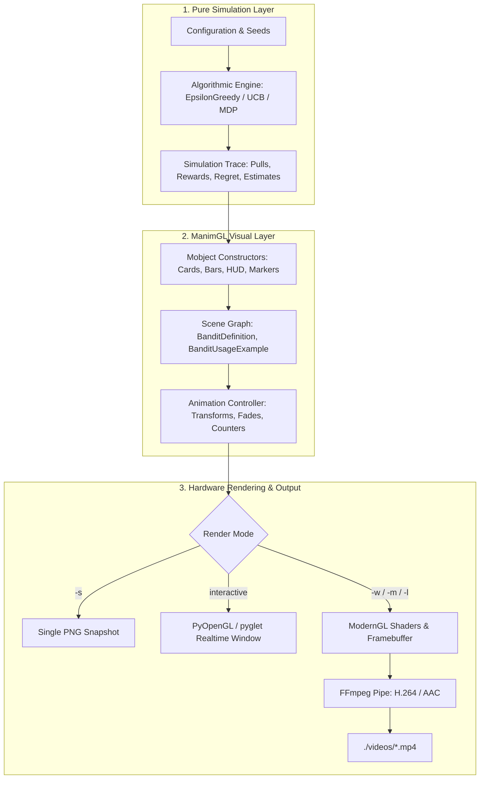
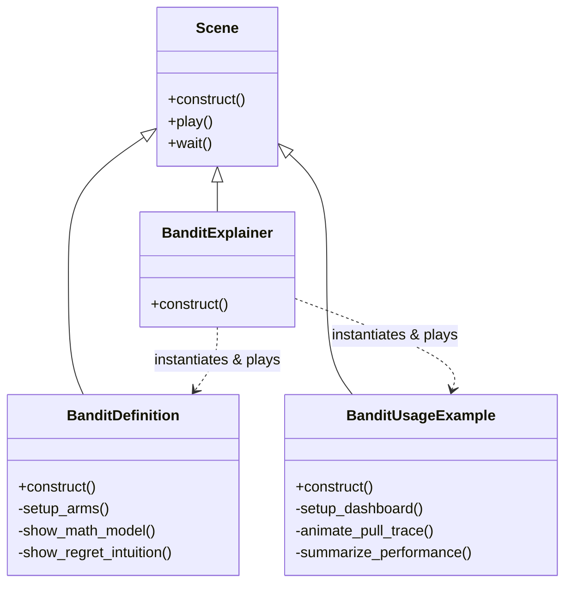

# TECH_SPEC.md — Technical Architecture & Data Flow Specification

This specification documents the rendering engine architecture, simulation data pipelines, configuration constraints, and data schemas for `RL-BLOG-ANIMATION`.

---

## 1. System Architecture Overview



---

## 2. Configuration & OS Compatibility Layer

### The `custom_config.yml` Override
ManimGL defaults to Grant Sanderson's (3Blue1Brown) personal setup, which requires Windows fonts and complex LaTeX packages. This repository uses a lean, cross-platform configuration:

```yaml
# custom_config.yml
tex:
  # Avoids full 3b1b preamble (physics, calligra, tipa) which causes compilation crashes
  template: "basic"
text:
  # macOS native fallback replacing unavailable Consolas
  font: "Helvetica"
```

### LaTeX Engine Constraints
- **Engine:** pdfLaTeX via system installation (`pdflatex`).
- **Template:** `basic` (contains standard AMS packages: `amsmath`, `amssymb`, `amsfonts`).
- **Syntax Rule:** All LaTeX strings in Python must use Python raw string literals:
  ```python
  # CORRECT:
  Tex(r"\mathcal{R}_T = \sum_{t=1}^T (\mu^* - \mu_{A_t})")

  # INCORRECT (causes escape warning / syntax error):
  Tex("\mathcal{R}_T = \sum_{t=1}^T (\mu^* - \mu_{A_t})")
  ```

---

## 3. Data Flow & Event Schemas

### 3.1 Simulation Event Schema
The simulation generates a precomputed sequential trace of rounds, structured as a tuple of typed events:

```python
# Type signature for a single round event:
# Tuple[arm_index: int, reward: int (0 or 1), mode: Literal["explore", "exploit"]]

PULLS = (
    (0, 0, "explore"),
    (1, 1, "explore"),
    (2, 1, "explore"),
    (1, 0, "exploit"),
    # ...
)
```

### 3.2 Dynamic State Calculation
At round $t$, the state of each arm $i \in \{0, 1, \dots, K-1\}$ is updated incrementally:

$$
N_i(t) = N_i(t-1) + \mathbb{I}(A_t = i)
$$

$$
\hat{\mu}_i(t) = \frac{\sum_{\tau=1}^t R_\tau \cdot \mathbb{I}(A_\tau = i)}{N_i(t)}
$$

$$
\text{Instantaneous Regret } r_t = \mu^* - \mu_{A_t}
$$

$$
\text{Cumulative Regret } \mathcal{R}_t = \mathcal{R}_{t-1} + r_t
$$

### 3.3 Visual Mobject Mapping
The simulation state maps directly to geometric Manim primitives:

| Data Field | Visual Mobject Type | Transform / Update Method |
| :--- | :--- | :--- |
| **Arm Identity & Color** | `RoundedRectangle`, `Text` | Fixed position, themed with `ARM_COLORS` |
| **True Mean $\mu_i$** | `DashedLine` or `Line` (white) | Placed at target height on bar track |
| **Running Estimate $\hat{\mu}_i$** | `Rectangle` (colored) | Dynamically resized via `bar.stretch_to_fit_height()` |
| **Action Mode ("explore"/"exploit")** | `Text` badge | Color shifted (`YELLOW` for explore, `GREEN` for exploit) |
| **Round Reward $R_t$** | `Text("+1")` or `Text("+0")` | `FadeIn` with upward translation, then `FadeOut` |
| **Cumulative Regret $\mathcal{R}_t$** | `DecimalNumber` | `ChangeDecimalToValue` or incremental update |

---

## 4. Scene Hierarchy & Lifecycle

Every module follows the composite scene pattern implemented in `multiarmed_bandit.py`:



### Composition Pattern
```python
class BanditExplainer(Scene):
    def construct(self):
        # 1. Play first movement
        BanditDefinition.construct(self)
        self.wait(1.5)
        # 2. Clear scene with smooth transition
        self.play(*[FadeOut(mob) for mob in self.mobjects])
        # 3. Play second movement
        BanditUsageExample.construct(self)
```

---

## 5. Performance Optimization & Rendering Flags

| Flag | Purpose | Resolution | Target FPS | Use Case |
| :--- | :--- | :--- | :--- | :--- |
| `-s` | Save final frame as image | 1080p | 0 (static) | Checking alignment & text clipping |
| `-l` | Low-resolution draft | 854x480 | 15 fps | Rapid animation timing checks |
| `-m` | Medium resolution | 1280x720 | 30 fps | Balanced quality / render speed |
| `-w` | Write production video | 1920x1080 | 60 fps | Final production release for blog / YouTube |
| *(none)* | Interactive preview | Display res | 60 fps | Real-time debugging (press 'Esc' to exit) |
